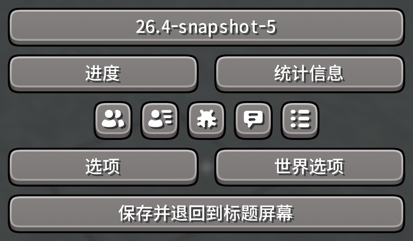

这个项目为Minecraft Java资源包CozyUI+进行1.21.11+的非官方续更。

部分纹理使用了Nieobie的开源免费图标包：https://github.com/Nieobie/game-icon-pack

部分纹理使用了Microsoft的Fluent Emoji：https://github.com/microsoft/fluentui-emoji

***

CozyUI+原作项目地址：https://github.com/Fogg05/CozyUI-Plus

CozyUI+ Modrinth下载：https://modrinth.com/resourcepack/cozyui-plus

***

此项目隶属于：依斯那（BiliBili）

我的主页：https://space.bilibili.com/3546612655721098

赞助/获取：https://afdian.com/a/ysn_mc_721098

***

注意：请将我的作品叠加在CozyUI+上面来使用！

注意：请将我的作品叠加在CozyUI+上面来使用！！

注意：请将我的作品叠加在CozyUI+上面来使用！！！
